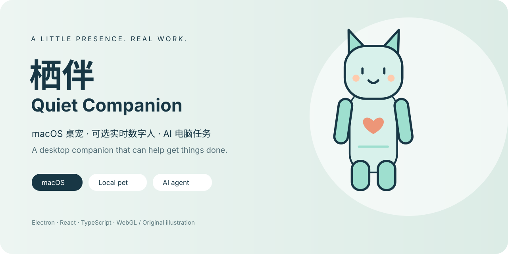

<p align="center"></p>

# 栖伴 · Quiet Companion for macOS

[](https://github.com/jamiu99/quiet-companion-macos/actions/workflows/check.yml) · [MIT License](LICENSE)

**一个安静待在桌面、也能帮你做事的 AI 陪伴应用。**

本地桌宠 + 可选 Vidu 实时数字人 + 独立 pi coding agent。用 Electron、React、TypeScript 与 WebGL，把陪伴、对话和电脑任务放进同一个轻量面板。

[English](README.en.md) · [快速开始](#快速开始) · [API 与授权](docs/API_AUTH.md) · [开发指南](docs/PROJECT_GUIDE.md) · [安全边界](SECURITY.md) · [发布清单](docs/LAUNCH.md)

> **状态：MIT 开源 / pre-release。** 当前没有正式签名安装包。仓库不包含 AliRTC SDK 或旧版生成素材。封面是原创示意图，不是实时运行截图。

## 不只是一个会动的挂件

| 能力 | 可以做什么 | 需要什么 |
| --- | --- | --- |
| **本地桌宠** | 待机形象、拖动缩放、置顶 / 桌面层、收纳到屏幕侧边 | 不需要 Key；公开副本使用代码生成的演示角色 |
| **AI 电脑任务** | 整理文件、处理文本、读写工作目录、调用 macOS 工具 | TokenDance / 兼容网关 Key；可能计费 |
| **可选实时陪伴** | 语音、动作、远端视频与任务进展播报 | Vidu Key + 使用者自行安装的匹配 RTC SDK；按服务规则计费 |
| **角色管理** | 自定义外观、人设、音色、图片和待机视频 | 自备有权使用的素材；在线生成另行计费 |
| **浏览器授权** | TokenDance Authorization Code + S256 PKCE，不复制新 Key 到设置页面 | 维护者先配置稳定仓库地址；也支持手动保存 Key |

本地待机不依赖云端，但**对话、素材生成、实时人物并非完全离线**。它也不是系统操作的安全沙箱。

## 快速开始

**环境：macOS、Node.js 24、npm。当前安装目标为 Apple Silicon / arm64。**

克隆源码并运行（安装依赖需要网络）：

```bash
git clone https://github.com/jamiu99/quiet-companion-macos.git
cd quiet-companion-macos
npm ci
npm run check       # 类型 → 构建 → 单测 → 真实 Electron / WebGL 回归，不调用付费服务
npm run dev
```

- 打开设置 → Agent，按 [API 填写说明](docs/API_AUTH.md) 配置 TokenDance。
- **只想用文字任务？先关闭「发消息自动连接」。** 配好实时依赖后，默认首次发消息可能创建计费 Vidu 会话。
- 实时数字人是可选能力；SDK 安装方法见 [RTC_SETUP.md](docs/RTC_SETUP.md)。缺失或摘要不匹配时，主进程会在创建新付费会话前拒绝连接。
- SDK 未安装时，本地待机与文字 Agent 不受这个检查限制。
- 本仓库已配置稳定授权归因地址。Fork 发布者请修改 `publication.json.repositoryUrl`，不要沿用他人的应用归因。
- 已装旧版本时先完全退出；普通启动可能使用既有用户配置。离线验证请用 `npm run check`，而非启动应用后尝试发消息。

## 设计重点

- **视觉稳定**：绿幕颜色置信度、背景连通性、立绘参照与构图保护；异常时保留好帧或切回待机，而不是逐帧放大人物。
- **进程分工**：main 管凭据 / IPC / 生命周期，renderer 管媒体与面板，独立 agent-host 执行任务。
- **可重复验证**：真实 WebGL alpha、视频 seek、图层互斥、文件访问边界与 OAuth loopback 回归，不只依赖 mocks。
- **少搬运秘密**：设置只读回脱敏配置；OAuth 新 Key 不回传 renderer；agent 模型 metadata 不再重复存 Key。

```text
React 桌宠 / 面板 ── 受校验 IPC ── Electron main
                                  ├─ Vidu 控制 → 可选 AliRTC 视频 → WebGL
                                  └─ JSONL → pi agent-host → 模型服务 / 本地工具
```

## 使用前知道这些

1. **凭据仍是 0600 权限明文配置，不是 Keychain 加密。** 同一用户权限的进程可能读取它。
2. Agent 可运行 shell / AppleScript、读写工作目录之外的文件；暂无逐工具审批，提示注入风险仍存在。
3. 画面保护只改变展示，不等于挂断或停止计费；用完实时会话仍需挂断。
4. `npm run check` 不需要真实 Key；不要把 `.env`、用户配置、完整日志或私人录屏提交到 issue。
5. 新授权尚需真实浏览器回跳验收；签名、公证、多屏与跨机器安装也仍在验收清单中。

## 导航

| 想了解 | 文档 |
| --- | --- |
| API Key、PKCE、费用与取消 | [API_AUTH.md](docs/API_AUTH.md) |
| 可选 RTC SDK、为什么不随源码附带 | [RTC_SETUP.md](docs/RTC_SETUP.md) |
| 架构、配置与修改入口 | [PROJECT_GUIDE.md](docs/PROJECT_GUIDE.md) |
| 离线测试、异常视频回放 | [HARNESS.md](docs/HARNESS.md) |
| 抠像、放大与透明问题的排查 | [MEDIA_PIPELINE.md](docs/MEDIA_PIPELINE.md) |
| 新账号接手、SEO、许可证与发布 | [LAUNCH.md](docs/LAUNCH.md) |
| 打包、源代码导出 | [DELIVERY.md](docs/DELIVERY.md) |
| 已知限制与后续方向 | [ROADMAP.md](docs/ROADMAP.md) |

## 参与与许可

欢迎讨论问题、提交修复和改进。参见 [贡献指南](CONTRIBUTING.md)、[社区约定](CODE_OF_CONDUCT.md) 和 [安全报告](SECURITY.md)。

项目源码、文档与仓库内原创演示素材采用 [MIT License](LICENSE)，保留既有版权署名。第三方依赖遵循各自许可证；未分发的 RTC SDK、模型服务及用户上传素材不受本项目 MIT 授权。详情见 [THIRD_PARTY_NOTICES.md](THIRD_PARTY_NOTICES.md)。
